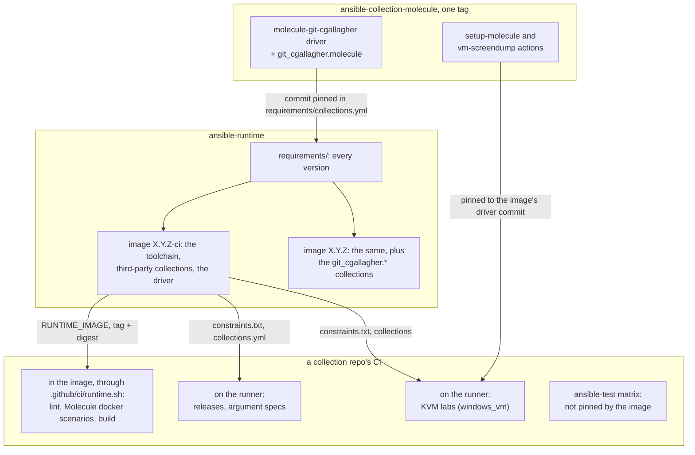

# Shared CI: the ansible-runtime image and the Molecule driver

Every `git_cgallagher.*` collection builds its CI from two shared pieces:

- **The ansible-runtime image** (this repo), `ghcr.io/git-cgallagher/ansible-runtime`: one pinned
  Ansible toolchain. Most CI jobs run inside it; the rest read their versions from it.
- **The Molecule driver**,
  [ansible-collection-molecule](https://github.com/git-cgallagher/ansible-collection-molecule): one
  tag ships the `molecule-git-cgallagher` driver, the `git_cgallagher.molecule` collection that
  creates and destroys test platforms, and the `setup-molecule` and `vm-screendump` GitHub Actions.

This page is the view from a collection repo: where its jobs run, which pins it holds, and how a
release of either piece reaches it. Each repo's own docs own the detail
([where to read more](#where-to-read-more)). It names no versions on purpose: they live in the pin
files and the release notes, and a copy here would go stale on the next bump.

## At a glance

## The image

One Dockerfile, two targets, each built for `linux/amd64` and `linux/arm64`:

| Target | Tag | Holds | For |
|---|---|---|---|
| `ci` | `X.Y.Z-ci` | ansible-core, ansible-lint, yamllint, Molecule, the Molecule driver and `git_cgallagher.molecule`, the controller-side Python the collections need (and their test tools), third-party collections | the collections' own CI. No collection under test is baked in, so a repo always tests its checkout |
| `runtime` | `X.Y.Z` | `ci` plus the `git_cgallagher.*` collections | running playbooks, and CI in repos that use the roles |

Collections are installed into Python's site-packages, where ansible-core always looks: a Molecule
config that replaces `ANSIBLE_COLLECTIONS_PATH` still finds them, and a repo's own checkout still
wins. Each image also carries two derived pin files for jobs that can't run inside it:
`/usr/share/ansible-runtime/constraints.txt` (every Python package, for `pip install -c`) and
`/usr/share/ansible-runtime/collections.yml` (that target's collection pins).

The driver comes from the commit pinned for `ansible-collection-molecule` in
`requirements/collections.yml`: one pin for both the pip driver and the collection, and
`tests/smoke.sh` checks that the two agree.

## The Molecule driver

With the driver, a scenario describes its platforms and nothing else: no `create.yml` or
`destroy.yml`. What one tag ships:

- **`molecule-git-cgallagher`**, the driver a scenario names (`driver: name: molecule-git-cgallagher`,
  usually once, in a shared base config). Its create and destroy playbooks each import the
  collection's.
- **`git_cgallagher.molecule`**, which does the work. Each platform goes to the role named by its
  `kind`: `docker` (the default; a container through the docker CLI) or `windows_vm` (a Windows
  Server box under QEMU/KVM, with WinRM forwarded to 127.0.0.1 and optional lab networks between
  VMs). The driver's `platform_defaults` option holds keys every platform shares. Two roles for a
  Windows lab's prepare step come with it: `ad_forest` (promote a VM to the first DC of a new forest)
  and `quiet_vm` (Windows Update and Defender real-time scanning off).
- **`setup-molecule`**, a composite action that installs Python, ansible-core, Molecule, the driver
  and the collection, the last two from the action's own commit, under an optional pip constraints
  file. With `kvm: 'true'` it enables KVM and installs QEMU too, and with `collections-image` it
  copies the other collections out of an ansible-runtime `-ci` image instead of downloading them
  from Galaxy.
- **`vm-screendump`**, a composite action a failed lab runs to print each VM's run state and QEMU
  log and save its screen.

What happens in a `molecule test`:

1. Molecule asks the driver for its `create` playbook, which is one
   `import_playbook: git_cgallagher.molecule.create`. If the collection isn't installed, that fails
   with "Could not find playbook", which is the guard.
2. The collection merges `platform_defaults` under each platform and runs each platform's kind
   role: `create` for all of them, then `ready` for all of them, so several VMs boot side by side.
3. Each kind records how to reach its platform (address, connection, port, user), which becomes the
   inventory that converge, idempotence and verify run against.
4. `destroy` runs each platform's kind, in reverse order.

A platform key the kind doesn't know fails the run, so a scenario can't stay green while ignoring a
setting it relies on.

## Where a consumer's jobs run

| Where | How | Versions from | Jobs (as of 2026-11-02) |
|---|---|---|---|
| **In the image** | `.github/ci/runtime.sh <command>` | the image; the job installs nothing | lint (isc, windows, aws, vmware); Molecule docker scenarios (isc, orchestration, aws, vmware); isc's Kea render; aws's and vmware's build; windows' argument specs |
| **On the runner** | reads `constraints.txt` (and `collections.yml`) out of the image, then `pip install -c` | the image's derived pin files | releases (`release.yml`, orchestration's `galaxy-publish.yml`); isc's argument specs, which loop over ansible-core minors; the [KVM labs](#the-kvm-labs) |
| **In ansible-test's containers** | `ansible-community/ansible-test-gh-action` | the matrix: ansible-core's stable branches, never `devel` | sanity, units, integration |

`runtime.sh` is a short wrapper each consumer keeps (copied from ansible-collection-isc):
`docker run --network host`, with the checkout mounted at the same path, the runner's Docker
socket, `TMPDIR` under the checkout and the checkout marked as a git `safe.directory`. It isn't a
`container:` job because that would move the checkout to `/__w` and the controller onto its own
network, which breaks tests that bind-mount checkout files into containers they start (isc's Kea
render) or reach published ports on 127.0.0.1 (isc's Stork scenarios). Each call is a fresh
container, so Molecule steps that share state go in one call: `molecule test`, or one
`runtime.sh bash -c '…'`.

The driver's own repo is the exception: its CI never runs in the image, which would test the baked
driver rather than its checkout. Its lint, Molecule and lab jobs run on the runner and install the
checkout through `./.github/actions/setup-molecule`, with the image's `constraints.txt` and
`collections-image`, and with Galaxy blocked in `/etc/hosts`, so any download left in them fails
the job.

### The KVM labs

`windows_vm` platforms need `/dev/kvm`, so the Windows labs run on the runner: isc's `windows-dc`
(run by hand), windows' `domain-lab`, and the driver's own `windows-lab`. A lab job:

1. takes `RUNTIME_IMAGE` from `ansible-test.yml` (`ci.yml` in the driver repo) and copies the
   image's `constraints.txt` out of it;
2. runs `setup-molecule` at a pinned commit, with `kvm: 'true'` and a `lab-dir` on the runner's
   large `/mnt` disk. The driver and `git_cgallagher.molecule` come from that commit, the Python
   packages at the image's versions, and the other collections from the image, one of two ways:
   - **`collections-image: <RUNTIME_IMAGE>`**: the action copies them out of the image and runs
     every `ansible-galaxy` call offline, so `requirements:` (the repo's own files) only checks
     them. A collection or version the image lacks fails the step ("Pin it in ansible-runtime's
     requirements/collections.yml first") instead of being downloaded. The action finds them
     through `ansible_collections.__path__` in the image's Python, which this repo's
     `tests/smoke.sh` checks is one directory holding every pinned collection, and it refuses a
     `runtime` image.
   - **Without it**, the job passes the image's `collections.yml`, minus `git_cgallagher.molecule`,
     as `requirements:`, and the action downloads those versions from Galaxy.
3. runs the scenario, and on failure `vm-screendump` (same commit) before the VMs are destroyed.

As of 2026-11-02 the driver's own CI uses `collections-image`, windows' `domain-lab` is moving to
it ([ansible-collection-windows PR 56](https://github.com/git-cgallagher/ansible-collection-windows/pull/56),
open), and isc's `windows-dc` still downloads from Galaxy.

## The pins a consumer holds

| Pin | Where | Moves |
|---|---|---|
| `RUNTIME_IMAGE: ghcr.io/git-cgallagher/ansible-runtime:X.Y.Z-ci@sha256:…` | one `env:` line in `.github/workflows/ansible-test.yml` (`ci.yml` in the driver repo). Other workflows read that line (`sed -n 's/^ *RUNTIME_IMAGE: //p'`), so it's set once | by hand, after an image release |
| `setup-molecule@<commit>` and `vm-screendump@<commit>`, each with a `# vX.Y.Z` comment | the KVM lab workflows | in a driver round, with the image's driver pin |
| Ranges: `galaxy.yml` dependencies, `requirements.yml`, `requirements.txt`, `tests/{unit,integration}/requirements.txt` | the collection; they're what Galaxy users install against | when the collection needs something new; the image pins a version inside the range first |
| The ansible-test matrix | `ansible-test.yml` | when ansible-core has a new stable branch |

Nothing else in a consumer picks an exact version, and a file that does is a bug to remove
([SHARED-DEPENDENCIES.md](SHARED-DEPENDENCIES.md) lists the deliberate exceptions).

A new image's digest, for `RUNTIME_IMAGE`, is the `Digest:` line of
`docker buildx imagetools inspect ghcr.io/git-cgallagher/ansible-runtime:X.Y.Z-ci`.

## Rules that span both repos

- **Every version is chosen in this repo's `requirements/`.** A consumer that adds or raises a
  dependency lands the pin here first. Until it does, this repo's `consumers` job fails on `main`,
  which is the alarm.
- **One driver everywhere.** The driver commit in `requirements/collections.yml` equals the
  `setup-molecule` commit in the consumers' labs, and they move in the same round. A round that stops
  halfway leaves the docker scenarios (in the image) on a different driver from the labs.
- **The driver repo's CI never runs in the image**; it only reads the image's constraints.
- **The image never pins the ansible-test matrices**: they exist to vary ansible-core.
- **A released image tag is never re-pointed** (the pipeline refuses to); fix forward with a new
  version.

## Releases

### The image

- **Automatically, for our collections:** after a `git_cgallagher.*` release on Galaxy, Renovate
  bumps its pin in `requirements/collections-runtime.yml` and merges once every check passes. The
  `release` job then tags that commit's images as the next patch version and writes the GitHub
  release. This starts once the Mend Renovate app is installed on this repo (AGENTS.md, TODO).
- **By hand, for everything else:** merge with a `## X.Y.Z` CHANGELOG entry, check the merge commit
  is on `main`, then push an annotated `vX.Y.Z` tag on it. Patch is a rebuild or docs, minor is any
  dependency bump (the driver's included), major is an ansible-core or Python minor, or a removal.

Either way, a consumer stays where it is until its `RUNTIME_IMAGE` is bumped, by hand, in each of
isc, windows, orchestration, aws, vmware and the driver repo. Automating that is Phase 3 of
[SHARED-DEPENDENCIES.md](SHARED-DEPENDENCIES.md).

### A driver release, and the round after it

A driver release is finished when the labs and the image both run it:

1. **Driver PR** in ansible-collection-molecule: the change, `galaxy.yml` and `pyproject.toml`
   bumped together, a CHANGELOG entry. Its `windows-lab` jobs aren't required checks, but merge only
   once they're green too.
2. **Consumer lab PRs** pin the driver PR's *head* commit in `setup-molecule@` and `vm-screendump@`
   (isc `windows-dc.yml`, windows `domain-lab.yml`) and prove it on real labs. isc's lab only runs by
   hand: `gh workflow run windows-dc.yml --repo git-cgallagher/ansible-collection-isc --ref <branch>`.
3. **Merge the driver PR and tag it `vX.Y.Z`**: on the PR's head if `main` didn't move meanwhile
   (its tree then equals the merge commit's), so the consumers' pins stay valid; otherwise on the
   merge commit, and re-pin the consumers.
4. **Merge the consumer lab PRs** one at a time: isc and windows publish to Galaxy on every merge,
   so wait for each release run.
5. **Image PR** here: the `ansible-collection-molecule` commit in `requirements/collections.yml`
   moves to the tag's commit (by hand; Renovate can't), with a CHANGELOG entry, then a minor release
   by hand.
6. **Bump `RUNTIME_IMAGE`** in the consumers, so their docker scenarios run the new driver too.

## Adding a collection repo

1. **Pins first, in this repo:** every collection it declares (and whatever those pull in) in
   `requirements/collections.yml`, inside its ranges; every Python package from its
   `requirements.txt` and `tests/*/requirements.txt` in `requirements/python.in` (then
   `tests/lock.sh`); the repo in the `consumers` job's clone, coverage, requirements and lint lists
   (`.github/workflows/build.yml`). Release the image. Once the collection is on Galaxy, add it to
   `requirements/collections-runtime.yml` too.
2. **The wrapper:** copy `.github/ci/runtime.sh` from ansible-collection-isc and change the
   collection name in its `.molecule-collections` link; set `RUNTIME_IMAGE` (the `-ci` tag and its
   digest) in `ansible-test.yml`'s `env:`; gitignore `.cache/` and `.molecule-collections/`.
3. **Jobs:** lint, Molecule docker scenarios and anything else that needs only the toolchain go
   through `runtime.sh`. A release workflow reads the image's `constraints.txt` (as aws's
   `release.yml` does). The ansible-test matrix stays on ansible-test-gh-action.
4. **Molecule:** one base config (`extensions/molecule/config.yml`, or `.config/molecule/config.yml`
   when the scenarios live under `roles/<role>/molecule/`) names `molecule-git-cgallagher` and puts
   `.molecule-collections` first in `ANSIBLE_COLLECTIONS_PATH`. Each scenario is then its platforms,
   `converge.yml` and `verify.yml`; the driver's README has a full example.
5. **Windows labs** go in a workflow of their own on the runner, as in
   [The KVM labs](#the-kvm-labs), with `setup-molecule` at the image's driver commit and
   `collections-image` set.
6. **Required checks:** add the new jobs to the repo's "main protection" ruleset once they've run,
   so their names are known.

## Locally

- `bin/ar <command>` (this repo) runs a command in the image in the current directory, with the
  Docker socket and your ssh agent. It uses the `runtime` target (`:latest`) unless
  `ANSIBLE_RUNTIME_IMAGE` names another, such as a consumer's `RUNTIME_IMAGE`.
- Work on the driver itself happens in a venv under the image's constraints, never in the image;
  the driver's AGENTS.md has the commands.

## When something breaks

| Symptom | Usual cause | Fix |
|---|---|---|
| `Failed to find driver` | Molecule running without the driver: not in the `-ci` image, and no `setup-molecule` | run it through `runtime.sh`, or install with `setup-molecule` |
| "Could not find playbook" for `git_cgallagher.molecule.create` | the pip driver is installed, the collection isn't | install both from the same commit, as `setup-molecule` does |
| This repo's `consumers` job fails on `main` with no change here | a consumer's `main` declared or raised a dependency the image doesn't pin | pin it here ([SHARED-DEPENDENCIES.md](SHARED-DEPENDENCIES.md)) |
| Renovate's `git_cgallagher.*` bump fails `image (runtime, …)` | that release raised a Python floor past `python.txt` | bump the pin in `python.in`, then `tests/lock.sh` ([DEPENDENCIES.md](../DEPENDENCIES.md)) |
| A separate `molecule prepare` after `molecule create` tries SSH | each `runtime.sh` call is a fresh container, so Molecule's state didn't carry over | one `molecule test`, or one `runtime.sh bash -c '…'` |
| Molecule tests a stale copy of the collection | `.molecule-collections` isn't first in `ANSIBLE_COLLECTIONS_PATH`; Molecule copies the project into `~/.ansible/collections` on every run | fix the base config |
| The docker scenarios and the labs disagree about the driver | a driver round stopped halfway | finish it ([the round](#a-driver-release-and-the-round-after-it)) |
| A Windows VM dies during first boot | QEMU exited or the guest stopped; the run fails at the next poll, not at the deadline | the failure quotes `<platform>-qemu.log`; `vm-screendump` prints the run state and log |
| A lab fails downloading a collection (timeout, 502) | the lab doesn't set `collections-image`, so it installs collections from Galaxy | re-run; move the lab to `collections-image` ([the KVM labs](#the-kvm-labs)) |
| setup-molecule fails with "Pin it in ansible-runtime's requirements/collections.yml first" | with `collections-image`, a requirements file names a collection, or a version, that the image doesn't have | pin it here, release the image, bump `RUNTIME_IMAGE` |
| setup-molecule refuses the image as "the runtime target" | `collections-image` got the `runtime` image, which holds the `git_cgallagher.*` collections under test | pass the `-ci` image |
| A job that loops over ansible-core versions can't resolve | the constraints also pin `resolvelib`, whose range differs per ansible-core minor | drop both `ansible-core` and `resolvelib` from the constraints ([SHARED-DEPENDENCIES.md](SHARED-DEPENDENCIES.md), exception 2) |

## Where to read more

| Doc | Owns |
|---|---|
| [README.md](../README.md) | the image's tags and targets; using it locally (`bin/ar`) and in GitHub Actions |
| [DEPENDENCIES.md](../DEPENDENCIES.md) | what's pinned where in the image, and what bumps each pin |
| [SHARED-DEPENDENCIES.md](SHARED-DEPENDENCIES.md) | the model (every version chosen here), its exceptions, its rollout phases |
| [AGENTS.md](../AGENTS.md) | the image's pipeline, releasing, rules and gotchas |
| the driver's [README](https://github.com/git-cgallagher/ansible-collection-molecule#readme) | writing scenarios: platform keys, `platform_defaults`, VMs and lab networks, `quiet_vm`, installing, adding a kind |
| the driver's [AGENTS.md](https://github.com/git-cgallagher/ansible-collection-molecule/blob/main/AGENTS.md) | internals (the kind contract, `windows_vm` networking and lifecycle), releasing, gotchas, what's been verified |
| the driver's [docs/MIGRATION.md](https://github.com/git-cgallagher/ansible-collection-molecule/blob/main/docs/MIGRATION.md) | how each collection moved onto the driver |
